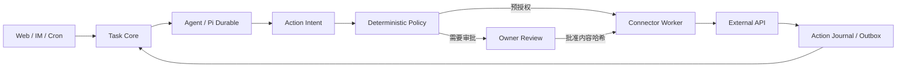

# 应用连接器平台 + Gmail 首发实现设计

**归属需求**：`CONN-001..011`, `GML-001..012`, `SEC-*`, `TASK-*`  
**产品原则**：*API-first, capability-scoped, approval-first for external side effects.*

## 1. 为什么要有独立“应用连接器”层

IM Connector（Telegram/飞书等）解决**人与 Agent 沟通**；App Connector（Gmail/Calendar/Drive/GitHub 等）解决**Agent 访问外部资源**。连接器不能直接由模型任意调用 HTTP；所有第三方动作统一走：



从 LLM 传来的请求只能产生**提议动作**，是否允许真正发送由程序策略决定。所有外部应用连接器至少实现：版本、健康状态、权限范围、动作描述、错误分类、断路器、审计、解除授权和测试替身。

## 2. AppConnector 契约（建议）

```ts
type ActionRisk = 'READ' | 'WRITE' | 'EXTERNAL_SEND' | 'DELETE' | 'FINANCIAL' | 'SYSTEM';
type ActionState = 'PROPOSED' | 'WAITING_APPROVAL' | 'APPROVED' | 'DISPATCHING' |
  'CONFIRMED' | 'FAILED' | 'SEND_UNCERTAIN' | 'CANCELLED';

interface AppConnector {
  manifest(): ConnectorManifest;         // actions + scopes + risk metadata
  startConnection(input: ConnectRequest): Promise<AuthorizationStart>;
  finishConnection(input: AuthorizationCallback): Promise<Connection>;
  testConnection(connectionId: string): Promise<ConnectionHealth>;
  revoke(connectionId: string): Promise<void>;
  executeAuthorizedAction(input: AuthorizedAction): Promise<ActionOutcome>;
}

interface ActionIntent {
  id: string;
  taskId: string;
  principalId: string;
  connectionId: string;
  actionName: string;
  inputHash: string;   // canonical JSON + file hashes + accountId
  risk: ActionRisk;
  status: ActionState;
  approvedAt?: string;
  approvalId?: string;
}
```

### 2.1 动作执行通用规则

1. `ToolDescriptor` 和 `ActionIntent` 不是同一个对象。工具注册描述**可能执行什么**，Intent 描述**这一回合具体打算执行什么**。
2. 执行前核对：Owner/来源身份 → Agent Profile 白名单 → 连接器账号 → scope → 接收对象/操作限制 → 审批哈希 → 预算/限流 → 幂等状态。
3. 所有带外部副作用的操作先在 SQLite 中登记，执行结果和可能重复风险持久化。`CONFIRMED` 才允许报告“已发送/已完成”。
4. 外部 API 超时后，若无法确定外部已经执行成功与否，必须停在 `UNCERTAIN`，不能无限重试。
5. MCP 客户端也要转换成同一套动作描述与权限审查；不能因为 MCP 是“工具标准”就绕过策略。
6. 连接器可申请独立的权限升级；从只发邮件到读取邮件必须**重新获得用户授权**。

## 3. Gmail 最小可行版本（P0）

### 3.1 使用 Gmail API，不默认使用 SMTP/App Password

- 第一个独立动作是 `gmail.send_email`，对应 Google Gmail API `users.messages.send`。
- 用户只授权 `https://www.googleapis.com/auth/gmail.send`，它是 Google 文档标识的 **Sensitive scope**。发送不需要获取整个邮箱的读取权限。
- `gmail.compose` 和 `gmail.readonly` 属于 **Restricted scopes**，只有 P1 真正需要云端草稿、收件箱读取时才单独请求。这可能带来更严格的公开应用验证与安全评估成本。
- 由私人自行部署和广泛公开发行是两种不同的 OAuth 合规情景。开发者需要按目标部署方式配置 Google Cloud 项目、同意屏幕和测试用户；不能保证所有账户/组织都允许 OAuth 授权。
- MVP 不支持自动大规模群发、不支持绕开 Gmail 发送限制、不支持未经授权的邮件营销。

### 3.2 授权流程（软路由无桌面环境）

**主方案**：管理员在 Web 设置里填写自己创建的 Google OAuth Client ID/必要配置，系统使用**标准 Authorization Code flow**；从 Web 点击“连接 Gmail”跳转 Google，回调到一个用户配置的、通过安全 HTTPS 代理访问的 HDA 域名；使用 `state`/nonce 和适用的 PKCE，回调收到 code 后兑换 token。开发必须符合 Google 对重定向 URI、OAuth client 类型与 PKCE 的最新要求。

**可选的本地辅助方案**：若用户只通过 LAN IP 访问软路由、没有可公开/可信 HTTPS 的回调地址，可以提供一个运行在用户个人电脑上的受控 OAuth 辅助端，使用 Google 支持的 Desktop loopback redirect 登录后，**经一次性配对和受保护传输**交付给 HDA。辅助端不是常驻必需依赖。**禁止**采用 Google 已弃用的 OOB“复制授权码”授权流程，也禁止把 refresh token 粘贴进普通 IM 对话。

状态机：`DISCONNECTED → AUTH_PENDING → CONNECTED → (EXPIRED → REFRESHED/NEEDS_REAUTH) → REVOKED`；支持 `ERROR` 状态和取消授权。

**秘密处理**：Refresh token 仅放在加密的 secrets store；AES-GCM 或等价 AEAD，加密主密钥独立于普通数据库备份/导出。主容器只能在执行授权动作时短时解封 token，返回给 Agent 的只有连接 ID 和 capability；日志与 SSE 不含秘密。撤销时要删除本地秘密并尽可能调用提供商撤销端点。

### 3.3 发送数据验证与 MIME 处理

```ts
interface SendEmailInput {
  connectionId: string;
  to: string[];        // required; explicit addresses
  cc?: string[];
  bcc?: string[];
  subject: string;     // 1..N chars within configured limits
  text: string;
  html?: string;       // sanitized or carefully constrained HTML
  attachments?: Array<{ artifactId: string; filename: string }>;
  replyTo?: string;
  threadId?: string;   // only when permission/compatibility is established
}
```

**发送前强校验**：

- 收件人需为合法 email 地址，不允许 Header CRLF 注入；未经用户确认不可从不可靠的网页文本推断真实邮件地址。
- 实际发送时使用 RFC 5322/MIME 编码与 Gmail 所需的 base64url message raw 数据；正确处理 UTF-8 subject、附件、CC/BCC、HTML/纯文本两种正文。
- 附件只能引用 HDA 受管 `artifactId`，不得从任意宿主机路径发送；校验文件大小、类型和总大小，不因文件名含 `../` 越界。
- 发送账号 `From` 必须与已授权 Gmail 账号/已验证别名相容；不允许任意伪造发件人。
- 生成标准 `Message-ID` 供审计/后续人工核对；若没有额外的邮件读取 scope，不得假设可以自动查询 Sent 文件夹确认状态。
- 实际发送完成后保存 Gmail API 响应的 `message.id` 与 `threadId`（如返回），并标记 `CONFIRMED`。不等于保证收件人的最终投递或阅读成功。

### 3.4 发信审批与预授权策略

默认 **Draft → Preview → Approval → Send**：

- 草稿可在聊天和 Web 中预览，但此处是**HDA 本地待发送意图**，不是 Gmail 原生草稿（如需要 Gmail 原生草稿须额外 `gmail.compose` scope）。
- 审批页面必须呈现完整收件人、主题、正文、附件摘要、账号、风险、发起任务、有效期；一个批准仅对 `account + action + normalized payload + attachment SHA-256` 精确有效。
- 用户可以在 Web 建立自动发送的例外规则，例如“每日将家中设备简报寄给我自己的邮箱”，但必须明确 `recipient allowlist + 指定 routine + 次数上限 + 有效期 + 禁止附件类型`，并可随时撤销。
- 任何改变收件地址、内容、附件、发送账号的动作会使既有批准失效。跨 profile / Subagent 不继承隐式发信权限。

### 3.5 幂等与不确定发送

Gmail `users.messages.send` 没有 HDA 可强制的通用 exactly-once 合约。状态流：

1. 生成 `ActionIntent`，校验并审批，持久化规范化内容哈希。
2. 原子记录 `DISPATCHING` 和本地 `attemptId`，执行 API。
3. 收到确认 → `CONFIRMED`（记录 Gmail ID）。已确认的意图再次调用返回历史结果，不再次发送。
4. 明确的授权/参数错误 → `FAILED`；明确尚未提交的连接错误可按策略安全重试。
5. **可能已经发出但响应丢失** → `SEND_UNCERTAIN`；停发、告警、允许人工查询；即使 Agent 重启也不自动再次发送同一意图。
6. 同一邮件需要用户明确“重新发送”时，创建新的 ActionIntent，标注与原不确定动作的关联，并二次提示重复风险。

### 3.6 错误分类与运营

| 错误 | 处理 | 用户可见状态 |
|---|---|---|
| Token 失效 / revoke | 禁止发送、请求重新授权 | `NEEDS_REAUTH` |
| Gmail 配额 / 429 | 不超过预算和重试上限，退避 | `RETRY_WAIT` 或 `FAILED` |
| 4xx 参数错误 | 不重试，编辑后重新审批 | `FAILED_VALIDATION` |
| 发送中响应超时，已发送概率不明 | **不盲目重试** | `SEND_UNCERTAIN` |
| 本系统被关闭或 Owner 撤销 | 取消未开始的发送动作 | `CANCELLED` |

### 3.7 Web 页面精确要求

`应用中心 / Gmail`：连接账号、scope 标签、连接状态、发送能力测试、OAuth 审核说明、授权失效提示、删除连接。

`待发送邮件`：与一般 `Approvals` 可合并，但有邮件特化预览；按风险排序、支持直接拒绝或编辑后重新提交。**不在 Agent 对话里展示 refresh token 或 OAuth code**。

`发送历史`：任务、收件人摘要、主题或脱敏主题、时间、Gmail ID、失败/不确定状态、审批人、源触发器；支持隐藏/清理本地邮件正文。

`发送规则`：规则有效期、目标名单、最大数量、每次任务限制、启用/停用、最后一次动作；仅 Owner 可变更。

## 4. 其他常见连接器的未来路线（不做无边界范围蔓延）

| 候选 | 典型动作 | 建议阶段 | 权限控制重点 |
|---|---|---|---|
| Google Calendar | 读取空闲、创建/修改事件 | P1 候选 | 日程隐私；发邀请需审批 |
| Google Drive | 搜索/读取/上传受管文件 | P1 候选 | 仅指定 folder/file，禁止任意泄漏 |
| GitHub | Issue/PR、CI 状态、创建评论 | P1 候选 | repo 级最小权限、外部写入审核 |
| Notion | 读取项目知识、创建页面 | P2 候选 | workspace/page 白名单 |
| Slack | 接收任务事件、发送审阅内容 | P2 候选 | 目标频道明确，避免跨 workspace 泄漏 |
| 通用 HTTP/Webhook | 接入用户自己的 API | P1 | host allowlist、SSRF、签名、幂等 |
| MCP Server | 包装各种已有 API | P1 | 每工具声明权限和副作用类型 |

## 5. 测试与完成定义

- 单元：邮件地址和编码、哈希审批、OAuth `state`、token storage、action 状态机、错分与重试上限。
- 契约：以假 Gmail 服务测试 200/401/403/429/5xx/timeout、重复执行、发送后丢确认。
- 集成：真实 Google 测试账号（**单独测试配置**）发送一封到受控收件箱，并保存已脱敏证据。
- 安全：从提示词诱导发信、通过 Skills/MCP 绕过审批、网页构造隐形收件人、附件路径遍历、CSRF 篡改发送内容。
- 用户流程：Web 完成首次 OAuth、草稿、批准、查看结果；Telegram 同样能触发但不能绕过审批。

P0 只有 `GM-001..005` 及 `CONN-001..008` 验收并经过实账号测试才算完工。没有配置 Google OAuth 项目时可以运行 Mock 测试，但 **不得声称 Gmail 实际发送已验收**。

## 6. 官方英文依据

1. [Gmail API: users.messages.send](https://developers.google.com/workspace/gmail/api/reference/rest/v1/users.messages/send)
2. [Gmail API: Choose scopes](https://developers.google.com/workspace/gmail/api/auth/scopes)
3. [Google OAuth sensitive-scope verification](https://developers.google.com/identity/protocols/oauth2/production-readiness/sensitive-scope-verification)
4. [Google OAuth policies](https://developers.google.com/identity/protocols/oauth2/production-readiness/policy-compliance)
5. [Gmail API guides](https://developers.google.com/workspace/gmail/api/guides)
