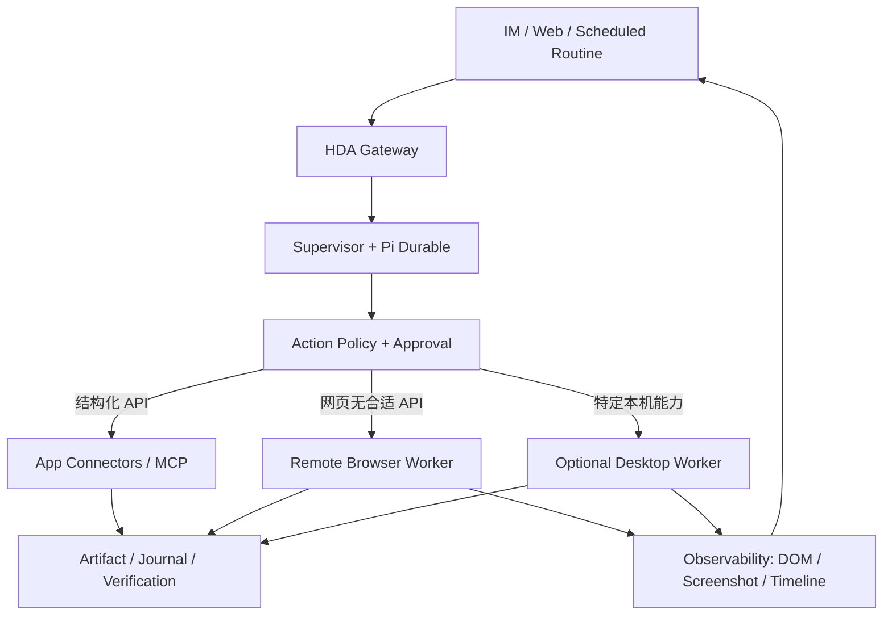

# Grok Bot 风格持续自动化：Bot Profiles + Computer Use 执行平面

**归属需求**：`CUA-001..016`, `BOT-001..008`, `AUTO-*`, `TASK-*`, `SEC-*`  
**目标**：实现“交办任务—长期执行—跨应用操作—随时查看—必要时审批—有证据地交付”，而不仅是一个会自动回复的 IM 机器人。

## 1. 参考边界与设备现实

官方 Grok Bot 由云计算机、连接器、Browser/Computer Use、Memory、Routines、审批与 Bot 协作构成；本项目借鉴**产品能力**而不是复制内部技术。Grok Bot 官方企业架构提及 Firecracker microVM 隔离；HDA 的 Docker 容器**不能被宣传为同等安全隔离等级**。

部署现实：软路由常驻 Docker 主容器负责 **control plane**，不承担长期的 GUI、浏览器和桌面密集型计算。默认安装在没有 Browser Worker 的情况下仍可完成 IM、Cron、Memory、Gmail 与普通 API 工具。

## 2. 目标分层



**关键规则**：Agent 只决定计划和提出操作，工具策略/账号权限/网络准入由非 LLM 层确定性执行；不允许使用普通主容器 shell 作为 Browser Worker 的“便捷替身”。

## 3. 执行环境的三种部署模式

| 模式 | 推荐场景 | 资源与隔离特点 | 初期状态 |
|---|---|---|---|
| A：独立 Browser Worker Docker 容器 | 软路由有足够内存、SSD | 另镜像/运行身份/网络，必须资源限额 | P1 可选 |
| B：NAS/服务器远程 Browser Worker | 软路由资源有限 | 软路由调度，浏览器在其他机器；强认证与受控回传 | P1 **优先建议** |
| C：Mac/PC Desktop Worker | 需要操作真实桌面软件 | 本机显式批准、应用 allowlist、短期授权 | P2 |

不应把 `network_mode: host`、`privileged: true`、Docker socket 作为任何默认 Worker 配置。若浏览器需要接近家庭内网的服务（比如 NAS Web UI），必须**单独**建立逐目标/逐账号能力授权；它不能顺便访问 OpenWrt/LuCI、路由器私有 IP、DHCP 或其他局域网设备。

## 4. Browser Worker 的执行合同

```ts
interface BrowserWorkerCapability {
  version: string;
  browserTypes: string[];
  supportsDomSnapshot: boolean;
  supportsScreenshot: boolean;
  supportsHumanTakeover: boolean;
  maxConcurrentSessions: number;
}

type BrowserAction =
  | { type: 'navigate'; url: string }
  | { type: 'snapshot' }
  | { type: 'click'; elementRef: string }
  | { type: 'type'; elementRef: string; text: string }
  | { type: 'select'; elementRef: string; value: string }
  | { type: 'scroll'; direction: 'up' | 'down'; amount: number }
  | { type: 'upload'; elementRef: string; artifactId: string }
  | { type: 'download'; elementRef: string }
  | { type: 'screenshot' };

interface BrowserStepRequest {
  sessionId: string;
  taskId: string;
  operationId: string;
  stepNumber: number;
  action: BrowserAction;
  policyGrantId: string;
}
```

- 操作必须有稳定 `operationId`、顺序号、执行前页面快照哈希、超时、状态和执行后截图/DOM 摘要。不能简单用“点击坐标”绕开策略检查。
- DOM/可访问性树优先：通常比全屏图像识别更节省 Token、稳定；截图点击作为回退方式。对动效/验证码/二步验证/反自动化挑战显示用户接管提示，不做规避。
- 提交前判断动作风险：例如点击“删除”“付款”“发送”“发布”属于高风险。**不能只依赖按钮文字判定**，还要看操作目标、表单字段、规则和允许域名；不确定则审批。
- 对浏览器网络地址做 DNS 解析前后和跳转后检查；禁止 `file://`、`data:` 可疑执行路径、未授权扩展、浏览器 DevTools 直通管理网络、对本地 metadata/管理端口的网络请求。
- 用户“接管”时 Worker 进入 `HUMAN_CONTROL`，Agent 工具调用被冻结，直到用户明确交还且再次读取页面当前状态。
- Worker 的屏幕、Cookie 和下载文件都视为**敏感数据**，会话之间不共享，除非用户明确设定共享范围；不得自动在多个 Bot 中共享账户登陆态。

## 5. 安全登录与 Secret Vault（P1 基础、P2 完善）

P1 必须允许用户通过独立、已认证的 Web 会话**自己在网站登录**。系统原则上不请求用户把密码发到 IM。登录凭据、TOTP、支付信息绝不传给 LLM 处理。

P1 建议只保存 Worker 中可合法复用的短期登录 session，并能手动清除。若持久 Cookie 被允许，则要加密静态存储、按域名/Worker/身份隔离、设置过期和强制撤销，不把其复制到导入/公开诊断文件。P2 才考虑 Vault 提供更复杂的凭据管理、敏感表单和自动填充。

## 6. Bot Profiles、任务所有权与 Routines

**Bot Profile** 是同一 HDA 实例中的逻辑工作身份，而不是无边界的独立进程。每个 Bot 必须带：`name, purpose, systemPromptVersion, modelPolicy, memoryScope, allowedActions, allowedAccounts, networkTargets, concurrency, budget, notificationPolicy`。

示例：

| Bot | 目标 | 允许能力 | 默认禁止 |
|---|---|---|---|
| 邮件秘书 | 整理输出并经 Gmail 发送 | 指定 Gmail 账号、联系人、Memory | Docker 管理、批量营销发送 |
| 网络观察员 | 读取已批准的监控 API | 特定只读接口与状态查询 | 更改软路由、防火墙、DNS |
| 研发协助员 | 跟踪已授权 GitHub 项目 | 指定 Repo 的只读/受审写操作 | 访问私人邮箱、未知仓库 |
| 浏览器助理 | 登录网站抓取报表 | Worker + 指定域名 | LAN 扫描、任意文件读取 |

**Routine** 是可持续执行的、版本化工作定义，关联触发器（Cron/Webhook/事件）、Bot Profile、Skills、连接器、输入、成功标准、失败策略、通知渠道。定义只能由 Owner 创建/确认；Agent 可以提出候选草稿。

**Supervisor** 必须负责：分派前确认作用域和预算；子任务全部有任务 ID、截止时间、最多重试次数；失败时自动重规划仅限低风险动作；对非幂等副作用返回审批；任务完结需验证 artifact/API 状态，不以模型自述替代交付证据。

## 7. 四种重点场景

### 场景 1：每天整理 Gmail 邮件（P1 可选）

需要额外授权 `gmail.readonly`，不得因为存在 `gmail.send` 就默认读取。触发器按设置执行；只检索允许的标签/查询，生成摘要；自动创建 HDA 发送草稿并通知审批。若将来采用 Gmail watch，需要明确 Google Pub/Sub 配置、推送签名/身份及事件去重。

### 场景 2：网站没有开放 API 的月报下载（P1）

用户从 IM 交办，HDA 在 Web 显示目标网站、预计动作、需要授权的域名；专用 Worker 打开浏览器；用户首次登录；Agent 每次使用 DOM 定位，抓取报表；下载后按内容/哈希校验；失败报告包含最后成功步骤、页面状态、截图和是否可重试。之后用户可以保存为 Routine。

### 场景 3：把工作交给一组 Bot（P1）

负责收集数据的 Bot → 负责分析的 Bot → 负责审阅的 Bot → Gmail 发送意图 → 用户批准。每步交付结构化 artifact 和费用记录。子 Bot 无法越权取得主 Bot 的 Gmail 权限，发信由有权主体或 Owner 审批。

### 场景 4：软路由故障排查（P2，可控内网目标）

监控工具只读采集网络指标；发现异常通知；如用户明确批准，特殊只读执行器可以获取 Docker 状态、容器日志；**不默认允许 Agent 更改网关、Firewall、DHCP、DNS 或 OpenWrt 配置**。需要改变系统时必须通过另行授权的受限 Executor 和人工批准。

## 8. Web Console 详细页面要求

1. **Bots**：创建 Bot 的引导式表单（名称、目标、模型、可用 App、技能、网络范围、预算、是否允许主动发起任务）；列表显示“正在执行 / 等待审批 / 出错 / 空闲”。
2. **Routines**：自然语言转模板草稿，结构化展示触发条件、依赖工具、目标系统、审批规则、通知方式；提供下一次运行时间与 Dry-run。
3. **Computer**：Worker 配对、状态/负载、会话列表、受控实时观察、动作日志与截图、接管/交还、禁用 Worker、清除会话。
4. **Task Timeline**：每步包括 Bot、工具、输入摘要、风险、审批、成本、结果/证据；截图与敏感输入按需隐藏。
5. **Notifications**：消息渠道规则、静默时段、未读审批、重复异常合并与回执。

## 9. 阶段性交付和测试

- **P0**：`ExecutionBackend` 定义、Fake Worker 契约测试和 Task Core 与 Policy Gateway 的组合能力，无需运行浏览器。
- **P1-1**：真实 Playwright Browser Worker，网络隔离、远端配对、动作/观察、用户接管和页面提交审批；达到 `CU-001..005`。
- **P1-2**：Bot Profile + Routine + Supervisor；完成 Gmail API 与 Browser Worker 混合场景；达到 `BT-001..002`。
- **P2**：完整桌面 Worker、Vault 和跨设备执行，明确资源、权限、兼容性范围。

**性能/安全基线**：Browser Worker 资源使用与主容器分开报告；中断 Worker 不应影响 Web/Telegram 任务；未授权局域网访问必须被测试阻断；真实网站若需付款/发布/发送必须显式批准且可验证。

## 10. 英文官方资料

- [xAI: Grok Bot Overview](https://docs.x.ai/grok-bot/overview)
- [xAI: How Grok Bot Works](https://docs.x.ai/grok-bot/how-grok-bot-works)
- [xAI: Grok Bot Teams & Enterprises](https://docs.x.ai/grok-bot/teams-and-enterprises)
- [OpenAI: Computer Use Tools](https://developers.openai.com/api/docs/guides/tools-computer-use)
- [Playwright Documentation](https://playwright.dev/docs/intro)
