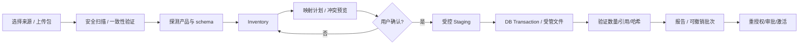

# OpenClaw / Hermes Agent 数据迁移与兼容——技术设计与验收

**归属需求**：`MIG-001..018`, `MEM-*`, `EXT-*`, `AUTO-*`, `SEC-*`  
**版本**：HDA v1.1；本文件是 `SRS.md` §3.12 的实现补充，不取代主规格书。

## 1. 目标和不可做的承诺

- 目标是实现 **离线、可预览、非破坏、可追溯、可重复** 的迁移。源 OpenClaw/Hermes 在迁移期间无需被 HDA 接管。导入后的目标数据有来源 ID、时间、哈希、导入批次。
- `Level A`：历史/配置/记忆/技能/定时任务的语义迁移，P0 必须；`Level B`：单向增量同步，P1；`Level C`：把来源运行中的工具调用或 checkpoint 直接转成 Pi Durable checkpoint，**非目标**。
- 不要求源框架和 HDA 的对话消息、执行器、权限结构完全一致。每项兼容能力必须根据实际版本做 fixture 测试。不得通过“对 LLM 说请帮我总结数据库”代替确定性解析。
- 源中包含不可信内容：历史消息、网页结果、技能脚本、提示词、导入备份均不得在导入时作为命令执行。

## 2. 来源发现与解析

### 2.1 OpenClaw

依官方英文文档，数据可能包含：`$OPENCLAW_STATE_DIR`（通常为 `~/.openclaw`）、配置 `openclaw.json`、凭据/认证、agent 会话、受管 Skills，以及可能位于**状态目录外部**的 workspace；不同版本的运行数据布局可能变化。OpenClaw 自身提供 backup/migrate 流程；优先接受经其官方备份生成的完整静态包，而非直接复制运行中的 SQLite DB。

**导入发现要求**：

1. 先读取 manifest 或探测 `version/config/DB schema`，识别配置 profile 和 workspace 相互引用关系；既不能假定所有文件都在一个目录，也不能猜单一固定 sqlite 表名。
2. 支持 `directory + workspace`、官方备份包两种输入，记录文件索引及 SHA-256。对于多个 profiles，必须给用户分别选取/合并。
3. 读取用户指定的 workspace `AGENTS.md`、`SOUL.md`、`USER.md`、`MEMORY.md` 等已知文件；未知上下文文件保留为受控附件并列为待映射。
4. 会话（含来源标识、消息、工具调用摘要、时间）建立只读时间线。若版本存在内容缺失，报告字段级损失。
5. 发现的 OAuth 凭据、Telegram/WhatsApp 状态、API key 仅列出“需要重新连接/审查”，不在常规迁移流程中复制。
6. 发现的自动化任务和第三方 Skills 默认禁用；若源还在运行，同一个 IM Bot token 和 Cron 不得在两个系统中同时激活。

### 2.2 Hermes Agent

依官方英文文档，主要目录 `~/.hermes/`：`config.yaml`、`.env`、`auth.json`、`SOUL.md`、`memories/`、`skills/`、`cron/`、`sessions/`、`logs/`。Hermes `state.db` 保存会话元数据和完整消息历史；`sessions/sessions.json` 是 Gateway 路由索引，**不是完整的会话列表**。

**导入发现要求**：

1. 对 `state.db` 进行 SQLite 完整性检查，识别 schema 版本（或应用的版本戳），用版本解析器读取消息及元数据。
2. 不把 `sessions/sessions.json` 误当全部会话；以 `state.db` 为已验证版本的主会话源。
3. 转换 `memories/MEMORY.md`, `memories/USER.md`, `SOUL.md` 为有来源的记忆或指令草案；原文留存，不擅自修改语义。
4. 通过白名单字段读取 `config.yaml`； `.env` / `auth.json` 绝不作为普通配置全文写入数据库。
5. 对 `cron/` 每个自动化定义做字段能力探测；缺少时区、目标频道、技能依赖的记录不得自动启用。
6. 对 `skills/` 的执行脚本仅静态记录哈希、文件清单、入口与依赖说明；不得安装依赖或执行 `postinstall`。

## 3. 通用数据模型

```ts
// 示意合同，实际代码必须定义 JSON Schema / Zod 与 DB migration。
type SourceSystem = 'openclaw' | 'hermes' | 'hda';
type ImportItemStatus = 'SUPPORTED' | 'PARTIAL' | 'CONFLICT' | 'SKIPPED' | 'UNSUPPORTED';
type ImportState = 'DISCOVERED' | 'PLANNED' | 'STAGED' | 'APPLYING' | 'VERIFYING' | 'COMPLETED' | 'FAILED' | 'ROLLED_BACK';

interface SourceImporter {
  probe(input: ReadonlySource): Promise<SourceInventory>;
  inventory(input: ReadonlySource): Promise<SourceInventory>;
  plan(inventory: SourceInventory, targetSnapshot: TargetSnapshot): Promise<MigrationPlan>;
  stage(plan: MigrationPlan, input: ReadonlySource): Promise<StagedImport>;
  apply(stage: StagedImport, approvedPlanHash: string): Promise<MigrationBatch>;
  verify(batchId: string): Promise<VerificationReport>;
  rollback(batchId: string): Promise<RollbackReport>;
}
interface ImportedIdentity {
  sourceSystem: SourceSystem;
  sourceInstanceId: string;
  sourceObjectType: string;
  sourceObjectId: string;
  sourceRevisionHash: string;
}
```

**必须落库的元数据**：源产品、源版本/提交号（若存在）、源 instance fingerprint、源对象类型/ID、原始时间、内容哈希、目标 ID、映射器版本、导入批次、兼容状态、告警、丢失字段清单。导入计划用规范化 JSON 算哈希，用户确认的是**计划快照**，而不是前端显示字符串。

## 4. 迁移流水线



- **输入**：上传压缩包，或者 HDA 通过专门 `:ro` 挂载读取临时目录。不能让 Agent 随意遍历宿主机或依赖在 OpenWrt 原生执行导入代码。
- **解包**：最大压缩前/解压后大小、条目数、嵌套层数、路径规范化、软链接和硬链接策略，防止 archive traversal / zip bomb。
- **一致性**：只有静态快照才直接解析数据库；活动 SQLite 源必须先由源的 backup API 或官方工具产生一致性快照。DB 与工作区要尽可能来自同一个时间点，否则报告弱一致性。
- **预览**：每类展示 `总数 / 完整映射 / 部分映射 / 跳过 / 冲突 / 需要授权`，按条目展开原始 ID、目标 ID、字段差异与风险。
- **提交**：先在受管 Staging 中完成全部解析，再执行应用数据库事务与文件受管提交。跨 DB/文件操作用 manifest + saga/补偿，不假设分布式事务。
- **回滚**：按批次撤销由该次新建的目标记录；已被用户后续修改的记录不强删，而显示冲突等待人工决定；第三方已产生的真实邮件/消息/外部任务无法回滚。
- **增量**（P1）：仅单向读取；源记录删除时不自动删除目标历史，标记 tombstone/conflict；来源实时文件发生变更采用稳定快照后增量比较。

## 5. “继续原来的对话”的具体实现

1. 原始消息作为 `imported_conversations/imported_messages` **只读归档**保存，按原顺序和时间显示。
2. 用户点击“从此继续”，系统在 Web 提供对话摘要/最近 N 条/选择相关片段的预览，尊重敏感信息过滤和模型上下文预算。
3. 新建本系统 `conversation` 和 Pi Durable 内部会话；注入**经过标注的历史背景材料**，不是伪装成真实新会话工具调用或系统权限。
4. 建立 `continued_from_imported_conversation_id` 和可跳转的历史来源。历史工具调用不可凭空重播；需要执行的新请求创建**新的受审任务**。
5. 经过压缩的摘要可让用户查看并手工纠正。涉及旧消息里的“忽略指令/直接发送”一律当作不可信历史文本。

## 6. 管理后台页面与交互

`数据迁移中心` 提供六步向导：

1. **来源**：OpenClaw / Hermes / HDA Export；选择 ZIP 或只读目录，并显示安全警告。
2. **扫描**：进度、产品版本、文件总量、可解析条目、格式异常。
3. **预览**：来源分类；能否完整导入；哪些需要重新授权、审批。
4. **冲突处理**：支持保留现有、新增副本、逐项合并；批量策略预览总影响。
5. **执行与验证**：执行任务条、错误明细、复核计数/链接、日志（默认脱敏）。
6. **结果**：浏览迁入数据、继续会话、重新连接邮箱/IM、启用已审查的定时任务、撤销导入批次。

需要额外提供“源版本兼容性”页：列出**实际测试过**的 OpenClaw 和 Hermes tag/commit/schema；未知版本显示 `UNVERIFIED`，只允许导入经检测安全支持的子集。

## 7. Fixture、边界与发布验收

至少建立各源两个已知版本的 fixture，包含：中英文消息、工具调用、压缩会话、Memory 冲突、未知模型字段、脚本 Skill、Cron、MCP、缺失附件、假 OAuth Key。另建立恶意测试包：路径穿越、符号链接、巨大解压比、损坏 sqlite、同 ID 不同内容、含 Prompt Injection 的历史消息。

自动化门槛：`MT-001..006` 必须通过；展示 `source_count, imported_count, skipped_count, conflict_count, unverifiable_count, data_loss_report` 并由脚本校验；任何隐含丢失必须使验收失败。

## 8. 英文来源与版本要求

- [OpenClaw Migration Guide](https://docs.openclaw.ai/install/migrating)
- [OpenClaw: Where Things Live on Disk](https://docs.openclaw.ai/help/faq/where-things-live-on-disk)
- [OpenClaw Agent Workspace](https://docs.openclaw.ai/concepts/agent-workspace)
- [Hermes Agent Sessions](https://hermes-agent.nousresearch.com/docs/user-guide/sessions)
- [Hermes Agent Configuration](https://hermes-agent.nousresearch.com/docs/user-guide/configuration)

正式开发时固定上游 tag/commit，按源码核实真实 DB schema。以上网页反映的是检索时的文档，不应被当作所有历史版本的永恒固定格式。
